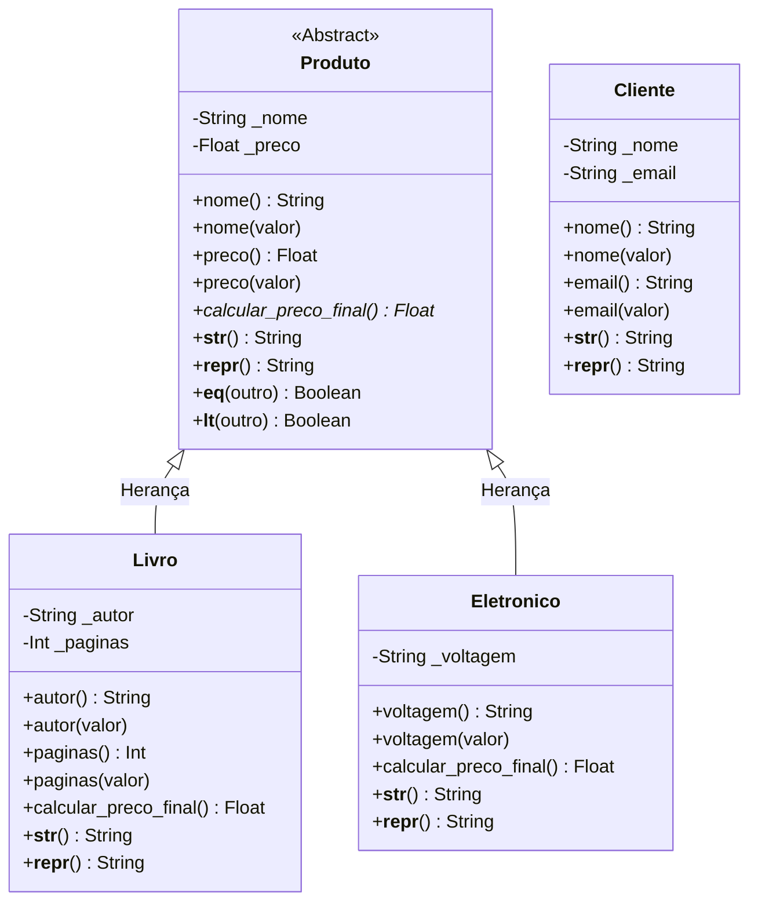

# Atividade da Sexta Semana - Orientação a Objetos

Este repositório contém a implementação da atividade prática sobre Programação Orientada a Objetos (POO) em Python, abordando conceitos de classes abstratas, herança, polimorfismo, encapsulamento e métodos mágicos (dunders).

## Diagrama de Classes (Mermaid)



## Justificativa das Decisões de Modelagem

A modelagem de classes seguiu os pilares da POO para evitar repetição de código e tornar a arquitetura extensível:

1.  **Herança (`Produto` -> `Livro` e `Eletronico`)**: 
    Optou-se pela Herança porque a relação entre essas classes é estritamente do tipo **"É UM"**. Um `Livro` *é um* `Produto` e um `Eletronico` *é um* `Produto`. Dessa forma, todos compartilham atributos genéricos (nome, preço) e podem ser agrupados sob um mesmo tipo na hora de criar listas ou sistemas de carrinho. A herança permite que utilizemos a função `super().__init__()` para não reescrever a atribuição do nome e do preço nas filhas.
    
2.  **Composição (ausente entre Produto e Cliente)**: 
    A classe `Cliente` foi criada separadamente para demonstrar o encapsulamento de e-mails, sem estar amarrada fisicamente a um Produto através de herança. Se o sistema fosse crescer para um E-commerce completo, o ideal seria que `Cliente` utilizasse *Composição* para conter uma lista de `Produto`s (um "Carrinho"), mantendo assim a relação "TEM UM" ou "POSSUI UM".

## Explicação das Validações Aplicadas com `@property`

O uso de `getters` e `setters` definidos por `@property` é vital para que os objetos nunca fiquem em um "estado inválido":

-   **`Produto.preco`**: O setter correspondente garante que um produto jamais terá um preço negativo ou um tipo não numérico (como passar uma string acidentalmente). Caso ocorra, lança um `ValueError`.
-   **`Produto.nome` e `Cliente.nome`**: O setter valida se a string está vazia (evitando um objeto "sem nome").
-   **`Livro.paginas`**: Valida se o número passado é do tipo `int` e, obrigatoriamente, maior que `0` (não existem livros com páginas negativas).
-   **`Eletronico.voltagem`**: Utiliza uma restrição de domínio em que os únicos valores permitidos são `110`, `220` ou `"Bivolt"`.
-   **`Cliente.email`**: O setter faz uso de Expressão Regular (`re`) para garantir que qualquer objeto da classe Cliente tenha um e-mail com estrutura válida (ex: contendo `@` e domínio).

## Exemplos de Uso (Testes e Demonstração)

Abaixo estão alguns exemplos simulados baseados no terminal de execução do arquivo `Atividade.py`.

### 1. Polimorfismo
No script principal, instanciamos tanto Livros quanto Eletrônicos dentro de uma única lista `produtos` genérica. Em seguida, iteramos sob ela usando o método `calcular_preco_final()`:
```python
for prod in produtos:
    # Mesmo método, mas o cálculo difere de acordo com o objeto!
    preco_final = prod.calcular_preco_final()
```
-   Para o **Livro**, o preço final tem **10% de desconto** (`preco * 0.90`).
-   Para o **Eletronico**, o preço final tem um acréscimo de **15% de imposto** (`preco * 1.15`).

### 2. Capturando Erros (Exceções de @property)
O encapsulamento proíbe a criação de objetos bizarros logo no `__init__` (que implicitamente chama o setter):

```python
try:
    # Isso falhará no @preco.setter
    Livro("Livro Ruim", -50, "Autor Desconhecido", 100)
except ValueError as e:
    print(e)
# Saída: O preço do produto 'Livro Ruim' deve ser um número positivo. Valor recebido: -50
```

### 3. Integração com a Linguagem (Métodos Dunder)
Foram implementados `__str__` (para exibição em prints limpos), `__repr__` (para depuração em listas) e, em `Produto`, foram adicionados `__eq__` (igualdade) e `__lt__` (menor que) com base no atributo `.preco`:
```python
prod1 = Livro("1984", 45.00, "George Orwell", 328)
prod2 = Livro("Revolução dos Bichos", 30.00, "George Orwell", 152)

print(prod2 < prod1) # Saída: True (pois 30 é menor que 45)
```

